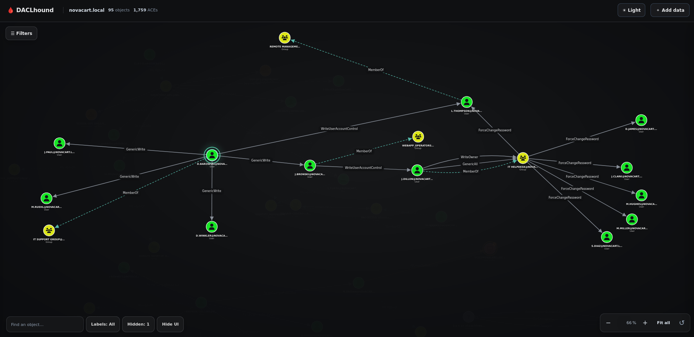

# DACLhound

DACLhound collects and analyzes Active Directory permissions over LDAP or native ADWS. Explore the results in the interactive graph viewer or run `analyze` for a quick terminal overview.

DACLhound is built for Hack The Box (HTB) and similar hands-on labs. It works best with small and medium-sized domains; performance in very large enterprise environments has not been evaluated.

Unlike BloodHound CE's modeled graph edges, DACLhound preserves the collected DACL details and exposes individual `Write-Property` rights by attribute (for example, `WriteLogonHours` or `WriteUserAccountControl`, etc.). This helps inspect the specific property and ACE behind a relationship.

## Development status

DACLhound is still under active development. I plan to update it daily as I continue testing it, fixing bugs, and improving the results. You may encounter issues, and feedback or bug reports are welcome.



## Demo

https://github.com/user-attachments/assets/62a531d9-c3f0-47d3-aab0-d7fef8db28d1

The demo walks through collecting a domain and opening the graph viewer. It also shows selecting an object to focus on its permission paths, hiding objects, and setting start and end nodes to reveal a path.

## Install

Python 3.10 or newer is required.

```sh
pipx install DACLhound
```

Upgrade later with:

```sh
pipx upgrade DACLhound
```

## Collect a graph

```sh
daclhound collect --host DC01.lab.local -d lab.local -u 'user' -p 'password' --dc-ip 192.168.2.1
```

`--host` accepts the domain controller's FQDN or IP address. Use the FQDN when authenticating with Kerberos.

By default, the graph is saved using the domain name in the current directory: the first collection creates `lab.local.json`, and later collections use the next available name, such as `lab.local_1.json`. Use `--output custom-name.json` only when you want to choose a custom path; existing files get the same numeric suffix. Pass `--overwrite` only when you want to replace the selected output file.

The collector is read-only. By default it collects users, groups, computers, OUs, containers, GPOs, the domain, trusts, Sites from the Configuration partition, Foreign Security Principals, and ADCS data. Use `--types` to limit directory object types:

```sh
daclhound collect --host DC01.lab.local -d lab.local -u 'user' -p 'password' --types users,groups
```

Use `--no-adcs` to skip ADCS collection. The graph uses the domain-based default filename described above. Add `--raw-output` to keep the collector's raw entries as well.

By default, `collect` tries LDAP, then falls back to native ADWS if LDAP cannot connect. Choose a transport explicitly with `--transport ldap` or `--transport adws`. ADWS uses TCP port 9389 and supports NTLM and Kerberos; `--secure` applies to LDAP only. DACLhound resolves schema GUIDs so attribute-level `Write-Property` rights remain visible.

LDAP visibility depends on the account used for collection. If you have multiple accounts with different directory permissions, collect the domain with each one; their results may reveal additional objects or ACLs. Load the resulting JSON files together in the graph viewer, or pass them together to `analyze` to combine their data.

## Analyze saved graphs

Run a quick console triage of saved graphs without opening the web viewer. `analyze` reports domain context, Domain Admins, effective permission paths, Kerberos roasting, delegations, ADCS findings, trusts, and other useful relationships. You can analyze several domains together; duplicate objects and relationships are combined:

```sh
daclhound analyze lab.local.json
daclhound analyze lab.local.json megacorp.local.json
daclhound analyze lab.local.json --from-user 'alice@lab.local'
```

By default, `analyze` traces effective permission paths from collected users, resolves trustees by SID across all supplied JSON files, and groups paths that share a trustee group. It also reports direct rights, domain membership, delegation, roasting, ADCS, and GPO link findings in prioritized sections. Use `--from-user` to focus the paths on one account. Output is colorized by default; use `--color never` to disable colors. This is a quick way to review findings from the terminal when you do not need the web viewer.

## Authentication

### NTLM password

```sh
daclhound collect --host DC01.lab.local -d lab.local -u 'user' -p 'password' --dc-ip 192.168.2.1
```

### NTLM pass-the-hash

Pass the NT hash directly, or use `LMHASH:NTHASH` when you have both hashes:

```sh
daclhound collect --host DC01.lab.local -d lab.local -u 'user' -hashes '613a519b5b0ef57c07bc6395aa1aff14' --dc-ip 192.168.2.1
```

### Kerberos

Kerberos supports a password, pass-the-hash, or an existing ccache. When using a
ccache, `-u` is optional; the identity is taken from the ticket. `-no-pass` is
an explicit flag for ccache authentication.

**Password:**

```sh
daclhound collect --host DC01.lab.local -d lab.local -u 'user' -p 'password' -k --dc-ip 192.168.2.1
```

**Pass-the-hash (NT hash used as the Kerberos RC4 key):**

```sh
daclhound collect --host DC01.lab.local -d lab.local -u 'user' -hashes '613a519b5b0ef57c07bc6395aa1aff14' -k --dc-ip 192.168.2.1
```

If both hashes are available, use `-hashes '<LMHASH>:<NTHASH>'`.

**Existing ccache:**

```sh
# Use the current KRB5CCNAME
daclhound collect --host DC01.lab.local -d lab.local -k -no-pass --dc-ip 192.168.2.1

# Or provide a ccache file directly
daclhound collect --host DC01.lab.local -d lab.local -k user.ccache -no-pass --dc-ip 192.168.2.1
```

An AES key enables Kerberos automatically: use `-aesKey '<AESKEY>'` (with `-u`). Add `-s` to use LDAPS.

## Open the graph

Run the viewer in the foreground and stop it with `Ctrl+C`:

```sh
daclhound graph --input lab.local.json
```

Or manage the viewer as a background service:

- Start the viewer without preloading a graph: `daclhound graph start`.
- Start the viewer and load a graph immediately: `daclhound graph start --input lab.local.json`.
- Check whether the background viewer is running: `daclhound graph status`.
- Stop the background viewer: `daclhound graph stop`.

The server listens on `127.0.0.1:8765` by default. Uploaded JSON files stay in memory while the server is running and are discarded when it stops. Use `--bind` and `--port` to change the listener. Run `daclhound collect --help` or `daclhound graph --help` for all options.

## License

MIT. See [LICENSE](LICENSE).
