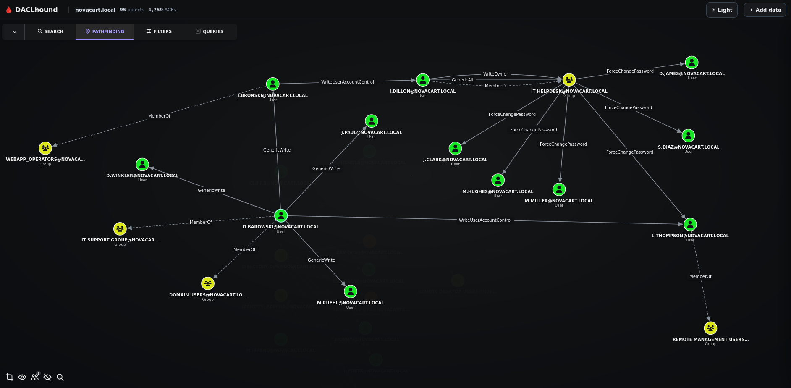

# DACLhound

DACLhound collects and analyzes Active Directory permissions over LDAP or native ADWS. Review DACLs and effective permission paths in an interactive graph, or triage saved data from the command line.

Unlike BloodHound CE's modeled graph edges, DACLhound preserves the collected DACL details and exposes individual `Write-Property` rights by attribute (for example, `WriteLogonHours` or `WriteUserAccountControl`). This helps inspect the specific property and ACE behind a relationship.



https://github.com/user-attachments/assets/d691098f-426c-4c34-ae8d-40e148de3154

## Install

Python 3.10 or newer is required.

```sh
pipx install DACLhound
```

Upgrade with `pipx upgrade DACLhound`.

## Collect

```sh
daclhound collect --host DC01.lab.local -d lab.local -u 'user' -p 'password' --dc-ip 192.168.2.1
```

By default, collection tries LDAP and falls back to ADWS if LDAP is unavailable. Choose `--transport ldap` or `--transport adws` to select one explicitly. ADWS uses TCP port 9389; `--secure` applies to LDAP only. Use the domain controller FQDN for Kerberos authentication.

The collector is read-only. It collects users, groups, computers, OUs, containers, GPOs, the domain, trusts, sites, Foreign Security Principals, and ADCS data. Limit directory object types with `--types`, or skip ADCS with `--no-adcs`:

```sh
daclhound collect --host DC01.lab.local -d lab.local -u 'user' -p 'password' --types users,groups --no-adcs
```

Output is saved as `lab.local.json` in the current directory; if that name exists, a numbered filename is chosen. Set a path with `--output`, replace an existing file with `--overwrite`, or retain raw collector entries with `--raw-output`.

### Optional host checks

Add `--host-checks` to check SMB signing policy and whether the WebClient service's `DAV RPC Service` pipe is available over SMB on collected computers. The checks require authentication to each computer; they do not perform HTTP/WebDAV requests. Use `--host-check-timeout` to set the per-host timeout and `--dns-server` to select a DNS resolver.

```sh
daclhound collect --host DC01.lab.local -d lab.local -u 'user' -p 'password' --host-checks --host-check-timeout 5 --dns-server 192.168.2.1
```

## Analyze

Get a prioritized terminal overview of permissions, membership, Kerberos exposure, delegation, ADCS, trusts, and GPO links:

```sh
daclhound analyze lab.local.json
daclhound analyze lab.local.json other-domain.json --from-user 'alice@lab.local'
```

Multiple input files are combined, with duplicate objects and relationships merged. Use `--color never` to disable colored output.

## Open the graph

Run the viewer in the foreground and stop it with `Ctrl+C`:

```sh
daclhound graph --input lab.local.json
```

Or manage the viewer as a background service:

- Start the viewer without preloading a graph: `daclhound graph start`.
- Start the viewer and load a graph immediately: `daclhound graph start --input lab.local.json`.
- Check whether the background viewer is running: `daclhound graph status`.
- Stop the background viewer: `daclhound graph stop`.

The server listens on `127.0.0.1:8765` by default. Uploaded JSON files stay in memory while the server is running and are discarded when it stops. Use `--bind` and `--port` to change the listener. Run `daclhound collect --help` or `daclhound graph --help` for all options.

## Authentication

### NTLM password

```sh
daclhound collect --host DC01.lab.local -d lab.local -u 'user' -p 'password' --dc-ip 192.168.2.1
```

### NTLM pass-the-hash

Pass the NT hash directly, or use `LMHASH:NTHASH` when you have both hashes:

```sh
daclhound collect --host DC01.lab.local -d lab.local -u 'user' -hashes '613a519b5b0ef57c07bc6395aa1aff14' --dc-ip 192.168.2.1
```

### Kerberos

Kerberos supports a password, pass-the-hash, or an existing ccache. When using a
ccache, `-u` is optional; the identity is taken from the ticket. `-no-pass` is
an explicit flag for ccache authentication.

**Password:**

```sh
daclhound collect --host DC01.lab.local -d lab.local -u 'user' -p 'password' -k --dc-ip 192.168.2.1
```

**Pass-the-hash (NT hash used as the Kerberos RC4 key):**

```sh
daclhound collect --host DC01.lab.local -d lab.local -u 'user' -hashes '613a519b5b0ef57c07bc6395aa1aff14' -k --dc-ip 192.168.2.1
```

If both hashes are available, use `-hashes '<LMHASH>:<NTHASH>'`.

**Existing ccache:**

```sh
# Use the current KRB5CCNAME
daclhound collect --host DC01.lab.local -d lab.local -k -no-pass --dc-ip 192.168.2.1

# Or provide a ccache file directly
daclhound collect --host DC01.lab.local -d lab.local -k user.ccache -no-pass --dc-ip 192.168.2.1
```

An AES key enables Kerberos automatically: use `-aesKey '<AESKEY>'` (with `-u`). Add `-s` to use LDAPS.

## License

MIT. See [LICENSE](LICENSE).
