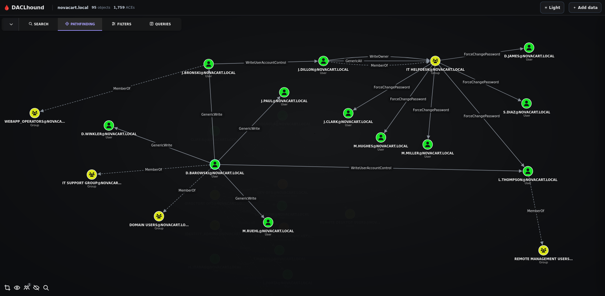

# DACLhound

DACLhound collects and analyzes Active Directory permissions over LDAP or native ADWS. Review DACLs and effective permission paths in an interactive graph, or triage saved data from the command line.

Unlike BloodHound CE's modeled graph edges, DACLhound preserves the collected DACL details and exposes individual `Write-Property` rights by attribute (for example, `WriteLogonHours` or `WriteUAC`). This helps inspect the specific property and ACE behind a relationship.

## 📚 Full Wiki & Documentation

Read the step-by-step [DACLhound Wiki](https://github.com/gzzcoo/DACLhound/wiki) for the Viewer, graph navigation, pathfinding, queries, and optional SCCM/MECM inventory. The guide includes screenshots and explains what the collected relationships mean.



https://github.com/user-attachments/assets/d691098f-426c-4c34-ae8d-40e148de3154

## Install

Python 3.10 or newer is required.

```sh
pipx install DACLhound
```

Upgrade with `pipx upgrade DACLhound`.

When a newer release is available, the CLI can offer to install it at startup. Choose **Skip** to dismiss the prompt for this run, or **Skip until next version** to hide it until a newer release is published. The update check runs only in an interactive terminal; set `DACLHOUND_NO_UPDATE_CHECK=1` to disable it.

## Collect

```sh
daclhound collect --host DC01.lab.local -d lab.local -u 'user' -p 'password' --dc-ip 192.168.2.1
```

By default, collection tries LDAP and falls back to ADWS if LDAP is unavailable. Choose `--transport ldap` or `--transport adws` to select one explicitly. ADWS uses TCP port 9389; `--secure` applies to LDAP only. Use the domain controller FQDN for Kerberos authentication.

The collector is read-only. It collects users, groups, computers, OUs, containers, GPOs, the domain, trusts, sites, Foreign Security Principals, and ADCS data. Limit directory object types with `--types`, or skip ADCS with `--no-adcs`:

```sh
daclhound collect --host DC01.lab.local -d lab.local -u 'user' -p 'password' --types users,groups --no-adcs
```

Output is saved as `lab.local.json` in the current directory; if that name exists, a numbered filename is chosen. Set a path with `--output`, replace an existing file with `--overwrite`, or retain raw collector entries with `--raw-output`.

### Optional host checks

Add `--host-checks` to check SMB signing policy and whether the WebClient service's `DAV RPC Service` pipe is available over SMB on collected computers. On domain controllers, it also reads LDAP signing and channel-binding policy values from the registry over Remote Registry RPC. These checks require authentication to each computer; LDAP policy values can remain unknown if Remote Registry access is unavailable. The WebClient check does not perform HTTP/WebDAV requests. `--host-check-timeout` sets the per-computer timeout (default 15 seconds); `--dns-server` selects a DNS resolver.

```sh
daclhound collect --host DC01.lab.local -d lab.local -u 'user' -p 'password' --host-checks --host-check-timeout 5 --dns-server 192.168.2.1
```

### Optional SCCM / MECM check

Add `--sccm` to query the `System Management` container, published sites and management points, potential PXE distribution points, SCCM/MECM-named principals, and computer objects. It then resolves computer FQDNs directly against `--dns-server` (or `--dc-ip`) and profiles SMB signing and share names on every discovered AD computer. It also checks TCP reachability for SQL (1433) and WSUS (8530/8531); an open port is only an indicator, not proof of that service. The same `--host-check-timeout` value applies to DNS, SMB, TCP, and `--host-checks`; its default is 15 seconds. The check is opt-in because it makes LDAP, SMB, and TCP requests to discovered computers and can take time in large domains; SMB role labels are based on observed shares and are not a complete SCCM configuration audit. DNS results are stored in the JSON and do not require `/etc/hosts` changes. `--sccm` requires LDAP and an IP address for the DNS server; it cannot be used with `--from-raw` or `--transport adws`.

```sh
daclhound collect --host DC01.lab.local -d lab.local -u 'user' -p 'password' --dc-ip 192.168.2.1 --sccm
```

The JSON includes an `sccm` section with LDAP findings and per-computer DNS/SMB evidence. When computer objects are included in the graph, selecting one also shows its SCCM indicators in **Object Information**.

The SCCM discovery workflow is inspired by [SCCMHunter](https://github.com/garrettfoster13/sccmhunter) by Garrett Foster (`@unsigned_sh0rt`), licensed under GPL-3.0.

## Analyze

Get a prioritized terminal overview of permissions, membership, Kerberos exposure, delegation, ADCS, trusts, and GPO links:

```sh
daclhound analyze lab.local.json
daclhound analyze lab.local.json other-domain.json --from-user 'alice@lab.local'
```

Multiple input files are combined, with duplicate objects and relationships merged. Use `--color never` to disable colored output.

### Organize a graph JSON for manual inspection

Large unified graph JSON files can be split into one JSON per object type and a shared `edges.json`, then packaged into an optional ZIP archive:

```sh
daclhound json split --input northbridge.corp.json --zip northbridge.corp.zip
```

The archive contains files such as `users_northbridge.corp.json`, `groups_northbridge.corp.json`, `computers_northbridge.corp.json`, and `edges.json`. The edge file keeps relationships between objects and includes a node index that maps endpoint IDs to their object type and file. `manifest.json` lists the contents and counts.

**This ZIP is only for organizing JSON for individual manual analysis. Do not upload it to the DACLhound viewer.** The viewer and `daclhound graph start --input` use the original unified JSON file. This command leaves that source file unchanged.

## Open the graph

### Recommended: keep one background graph server running

Start the graph server once. You can preload your first collection:

```sh
daclhound graph start --input lab.local.json
```

Or start with an empty graph and import JSON files from **Add data** in the viewer:

```sh
daclhound graph start
```

Keep this single server running while you use DACLhound. You can run `daclhound collect` repeatedly, including with different accounts that may have different directory permissions. Each collection writes its own JSON file; add later files to the already-open viewer with **Add data → Import JSON files**. You do not need to stop and restart the graph server for each collection.

The background server continues running after the `graph start` command returns. Check it with `daclhound graph status`; stop it when you are finished with `daclhound graph stop`. Datasets uploaded in the browser are held in memory and are discarded when the server stops, so keep the original JSON files if you want to load them again later.

### Foreground alternative

You can run the viewer in the foreground instead:

```sh
daclhound graph --input lab.local.json
```

Keep that terminal open while using the viewer; `Ctrl+C` stops the server. To start without an initial file, run `daclhound graph` and import JSON files from **Add data**. In either mode, collect data from another terminal and upload each resulting JSON into the same running viewer.

The server listens on `127.0.0.1:8765` by default. Uploaded JSON files stay in memory while the server is running and are discarded when it stops. Use `--bind` and `--port` to change the listener. Run `daclhound collect --help` or `daclhound graph --help` for all options.

## Authentication

### NTLM password

```sh
daclhound collect --host DC01.lab.local -d lab.local -u 'user' -p 'password' --dc-ip 192.168.2.1
```

### Cross-forest collection

When collecting from a trusted forest with an account from another forest, point `--host` to a domain controller in the forest you want to query. Set `-d` to the account's logon domain, and pass only the username to `-u` (do not prefix it with `DOMAIN\`; DACLhound uses `-d` to qualify the username).

For example, if `analyst` belongs to `lab.local` and `lab.local` has a bidirectional trust with `megacorp.local`, the collection command can look like this:

```sh
daclhound collect --host DC01.megacorp.local -d lab.local -u 'analyst' -p 'P@ssw0rd01!' --dc-ip 192.0.2.10
```

Replace `192.0.2.10` with the IP address of `DC01.megacorp.local`. The trust must permit the account to authenticate, and the account must have sufficient directory permissions for the data you want to collect.

### NTLM pass-the-hash

Pass the NT hash directly, or use `LMHASH:NTHASH` when you have both hashes:

```sh
daclhound collect --host DC01.lab.local -d lab.local -u 'user' -hashes '613a519b5b0ef57c07bc6395aa1aff14' --dc-ip 192.168.2.1
```

### Kerberos

Kerberos supports a password, pass-the-hash, or an existing ccache. When using a
ccache, `-u` is optional; the identity is taken from the ticket. `-no-pass` is
an explicit flag for ccache authentication.

**Password:**

```sh
daclhound collect --host DC01.lab.local -d lab.local -u 'user' -p 'password' -k --dc-ip 192.168.2.1
```

**Pass-the-hash (NT hash used as the Kerberos RC4 key):**

```sh
daclhound collect --host DC01.lab.local -d lab.local -u 'user' -hashes '613a519b5b0ef57c07bc6395aa1aff14' -k --dc-ip 192.168.2.1
```

If both hashes are available, use `-hashes '<LMHASH>:<NTHASH>'`.

**Existing ccache:**

```sh
# Use the current KRB5CCNAME
daclhound collect --host DC01.lab.local -d lab.local -k -no-pass --dc-ip 192.168.2.1

# Or provide a ccache file directly
daclhound collect --host DC01.lab.local -d lab.local -k user.ccache -no-pass --dc-ip 192.168.2.1
```

An AES key enables Kerberos automatically: use `-aesKey '<AESKEY>'` (with `-u`). Add `-s` to use LDAPS.

## License

GPL-3.0-only. See [LICENSE](LICENSE).
