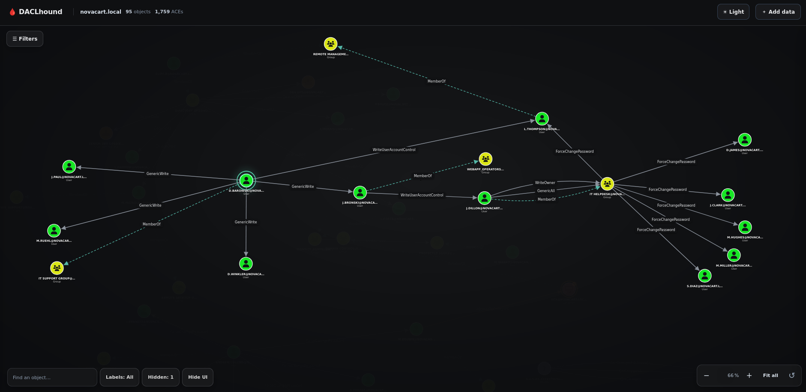

# DACLhound

DACLhound collects Active Directory security descriptors over LDAP and turns the results into a graph you can inspect in a browser. The collector uses bloodyAD as a Python library; it does not run the `bloodyAD` command.

It is primarily intended for Hack The Box (HTB) and similar hands-on labs, and works best with lab-sized or otherwise moderate Active Directory environments. It is not designed or performance-tested for very large enterprise domains.

Unlike BloodHound CE's modeled graph edges, DACLhound preserves the collected DACL details and exposes individual `Write-Property` rights by attribute (for example, `WriteLogonHours` or `WriteUserAccountControl`). This helps inspect the specific property and ACE behind a relationship.



## Install

Python 3.10 or newer is required.

```sh
pipx install DACLhound
```

Upgrade later with:

```sh
pipx upgrade DACLhound
```

## Collect a graph

```sh
DACLhound.py collect --host "$FQDN" -d "$DOMAIN" -u 'user' -p 'password' --dc-ip "$IP" --output "$DOMAIN.json"
```

The collector is read-only. By default it collects users, groups, computers, OUs, containers, GPOs, the domain, and ADCS data. Use `--types` to limit directory object types:

```sh
DACLhound.py collect --host "$FQDN" -d "$DOMAIN" -u 'user' -p 'password' --types users,groups --output users-and-groups.json
```

Use `--no-adcs` to skip ADCS collection. The normalized graph is written to `--output`. Add `--raw-output` to keep the bloodyAD response as well.

## Authentication

### NTLM password

```sh
DACLhound.py collect --host "$FQDN" -d "$DOMAIN" -u 'user' -p 'password' --dc-ip "$IP" -o "$DOMAIN.json"
```

### NTLM pass-the-hash

Use `LMHASH:NTHASH`; if you only have the NT hash, leave the LM field empty:

```sh
DACLhound.py collect --host "$FQDN" -d "$DOMAIN" -u 'user' -hashes ':<NTHASH>' --dc-ip "$IP" -o "$DOMAIN.json"
```

### Kerberos

Kerberos supports a password, pass-the-hash, or an existing ccache. When using a
ccache, `-u` is optional; the identity is taken from the ticket. `-no-pass` is
an explicit flag for ccache authentication.

**Password:**

```sh
DACLhound.py collect --host "$FQDN" -d "$DOMAIN" -u 'user' -p '<password>' -k --dc-ip "$IP" -o "$DOMAIN.json"
```

**Pass-the-hash (NT hash used as the Kerberos RC4 key):**

```sh
DACLhound.py collect --host "$FQDN" -d "$DOMAIN" -u 'user' -hashes '<LMHASH>:<NTHASH>' -k --dc-ip "$IP" -o "$DOMAIN.json"
```

If only the NT hash is available, use `-hashes '<NTHASH>'`.

**Existing ccache:**

```sh
# Use the current KRB5CCNAME
DACLhound.py collect --host "$FQDN" -d "$DOMAIN" -k -no-pass --dc-ip "$IP" -o "$DOMAIN.json"

# Or provide a ccache file directly
DACLhound.py collect --host "$FQDN" -d "$DOMAIN" -k user.ccache -no-pass --dc-ip "$IP" -o "$DOMAIN.json"
```

An AES key enables Kerberos automatically: use `-aesKey '<AESKEY>'` (with `-u`). Add `-s` to use LDAPS.

## Open the graph

Run the viewer in the foreground and stop it with `Ctrl+C`:

```sh
DACLhound.py graph --input "$DOMAIN.json"
```

Or run it in the background:

```sh
DACLhound.py graph start --input "$DOMAIN.json"
DACLhound.py graph status
DACLhound.py graph stop
```

The server listens on `127.0.0.1:8765` by default. Uploaded JSON files stay in memory while the server is running and are discarded when it stops. Use `--bind` and `--port` to change the listener. Run `DACLhound.py collect --help` or `DACLhound.py graph --help` for all options.

## License

MIT. See [LICENSE](LICENSE).
